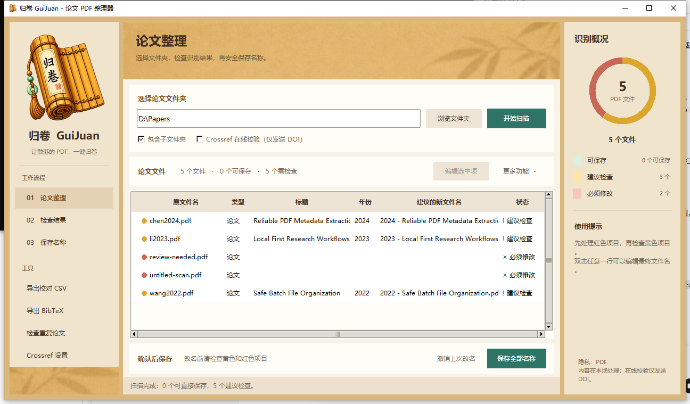

# 归卷 GuiJuan

> 让散落的 PDF，一键归卷。

归卷（GuiJuan）是一款开源的 Windows 论文 PDF 整理器。它可以提取论文信息、通过 DOI 或 arXiv 在线校验，在人工预览确认后批量重命名，并支持撤销最近一次改名。

当前版本为 `v0.4.0`。未经人工确认，程序不会修改 PDF。



## 直接使用 Windows 版

从 [GitHub Releases](https://github.com/Revoluuu/GuiJuan/releases) 下载 `GuiJuan-v0.4.0-windows-x64.zip`，解压后双击 `GuiJuan.exe`。无需安装 Python。

Windows 可能提示“未知发布者”。这是因为早期开源版本尚未购买代码签名证书；你可以从本仓库核对源码、发布说明和 SHA-256 校验值。

## 图形界面（推荐）

```powershell
Set-Location F:\Github-work\paper-folder
python paper_folder_gui.py
```

界面中的标准流程是：

```text
选择文件夹 → 扫描文件 → 检查红色项目 → 双击修改
→ 一键保存名称 → 必要时撤销
```

主表会同时显示原文件名和建议的新文件名。左侧圆点和右侧识别概况使用绿色、黄色、红色区分可保存、建议检查和必须修改；双击任意一行，或点击“编辑选中项”，可以直接修改文档类型、标题、作者、年份、DOI 和最终文件名。人工保存后该行会恢复正常。确认表格无误后点击“保存全部名称”，在确认框中选择“是”即可，不必先导出 CSV。

主窗口使用左侧流程导航、中间论文表格和右侧识别概况的三栏布局。「载入校对 CSV」在表格上方，导出、重复检查及 Crossref 设置在侧栏。扫描在后台运行，底部显示进度，可以点击「取消扫描」。Crossref 邮箱可留空。

表格上方的「自定义命名」支持勾选并排序年份、标题、作者、期刊和 DOI，保存前会实时显示示例文件名。默认格式为 `年份 - 标题.pdf`。归卷从 PDF 内嵌信息和首页引文识别期刊，在线校验可进一步补全。缺失时会跳过该字段并提示，也可以在「编辑选中项」中手动补填。若目标文件名已存在，图形界面会自动追加 `(2)`、`(3)` 等安全后缀。

首次启动时，内嵌引导会逐步描边标出主界面的实际按钮。完成或跳过后不会重复显示，可从侧栏「使用帮助」重新打开。命名规则、在线校验、子文件夹选项、Crossref 邮箱和引导状态保存在当前 Windows 用户的应用设置目录中。

程序会区分 `paper`、`appendix`、`book` 和 `other`。例如以 `Appendix B` 开头的文档会识别成附录，默认建议：

```text
Appendix - Essential Statistical Thermodynamics.pdf
```

## 使用

在 PowerShell 中进入项目目录：

```powershell
Set-Location F:\Github-work\paper-folder
python -m paper_folder "C:\你的论文文件夹"
```

递归扫描子文件夹：

```powershell
python -m paper_folder "C:\你的论文文件夹" --recursive
```

识别论文信息：

```powershell
python -m paper_folder "C:\你的论文文件夹" --recursive --metadata
```

结果中的 `complete` 表示四项信息均已识别；`partial` 表示需要人工补充；`scanned/unknown` 通常表示扫描版 PDF 没有可搜索文字。识别结果只是预览，不会写回 PDF。

使用 DOI 在 Crossref 校验标准标题、作者和出版年份；标准 arXiv 文件名会通过 arXiv 官方记录校验：

```powershell
python -m paper_folder "C:\你的论文文件夹" --recursive --metadata --online --email "你的邮箱"
```

邮箱不是账号，也不会写进项目；它只用于 Crossref 推荐的礼貌访问标识。网络失败时程序会保留本地结果。

预览建议的新文件名（仍然不会重命名）：

```powershell
python -m paper_folder "C:\你的论文文件夹" --recursive --preview
```

默认格式是 `年份 - 标题.pdf`。也可以使用标题、作者、年份和 DOI 自定义格式：

```powershell
python -m paper_folder "C:\你的论文文件夹" --preview --name-template "{authors} - {year} - {title}"
```

导出可以用 Excel 修改的校对表：

```powershell
python -m paper_folder "C:\你的论文文件夹" --recursive --online --export-csv papers.csv
```

修改 `papers.csv` 中的标题、作者、年份或 DOI 后，重新载入并预览：

```powershell
python -m paper_folder "C:\你的论文文件夹" --review-csv papers.csv --preview
```

确认校对无误后执行改名：

```powershell
python -m paper_folder "C:\你的论文文件夹" --review-csv papers.csv --apply
```

程序会再次显示完整预览，并要求输入大写的 `RENAME`。信息不足的论文会跳过；名称冲突时操作会中止。每次成功改名都会在论文根目录生成 `.paper-folder-history.json`。

撤销最近一次改名：

```powershell
python -m paper_folder "C:\你的论文文件夹" --undo
```

检查重复 DOI 或相同标题与年份：

```powershell
python -m paper_folder "C:\你的论文文件夹" --recursive --online --duplicates
```

导出 BibTeX：

```powershell
python -m paper_folder "C:\你的论文文件夹" --recursive --online --export-bibtex papers.bib
```

## 构建 Windows 程序

```powershell
powershell -ExecutionPolicy Bypass -File .\build_exe.ps1
```

完成后生成：

```text
dist\GuiJuan.exe
```

`GuiJuan.exe` 是单文件 Windows 程序，目标电脑不需要预先安装 Python。首次启动会先解包运行组件，可能比后续启动稍慢。

## 测试

```powershell
python -m unittest discover -s tests -v
```

## 当前边界

- 只识别扩展名为 `.pdf` 的文件。
- 当前不会对扫描图片执行 OCR。
- 自动识别结果可能不准确，后续重命名前必须预览确认。
- 在线校验只覆盖已经识别到 DOI 或标准 arXiv 编号的论文，不进行高风险的模糊匹配。
- Undo 只撤销由本程序记录的最近一次有效改名操作。

## 隐私与网络

- PDF 内容和文件名处理均在本地完成。
- 开启 Crossref 在线校验时，仅发送识别到的 DOI；邮箱是可选的请求联系信息。
- 标准 arXiv 文件名可访问 arXiv 官方接口校验。
- 网络失败不会阻止使用本地识别结果。

## 开源许可

本项目采用 [GNU General Public License v3.0](LICENSE)（`GPL-3.0-only`）。你可以使用、修改、分发和销售本软件；如果向他人分发修改版或可执行文件，也必须按 GPL-3.0 提供对应源代码、保留许可证，并给予接收者同样的修改与再分发权。付费打包、安装指导、更新和技术支持属于额外服务。

## 支持项目

如果归卷帮你节省了整理论文的时间，可以点击仓库页面顶部的 **Sponsor** 支持后续开发。赞助不会改变 GPL-3.0 授予的使用权，也不会影响免费版本的正常使用。

## 下一步

1. 可选 OCR，用于纯扫描版 PDF。
2. 扩充真实论文样本评测，继续提高标题与文档类型识别准确率。
